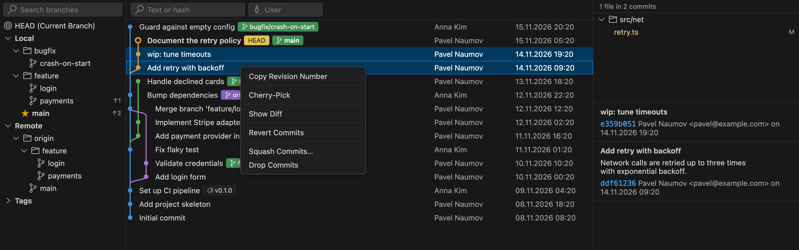
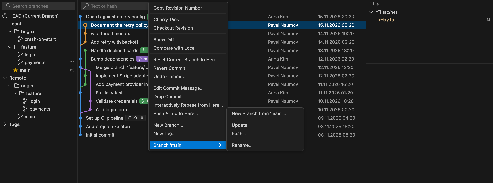
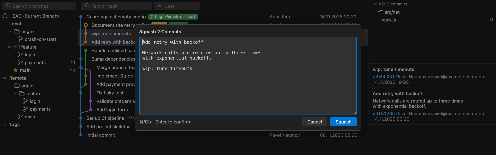
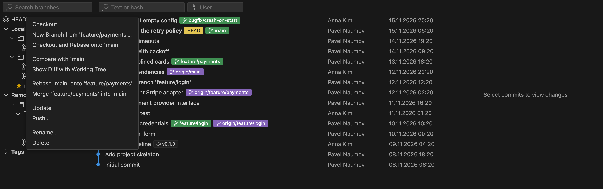
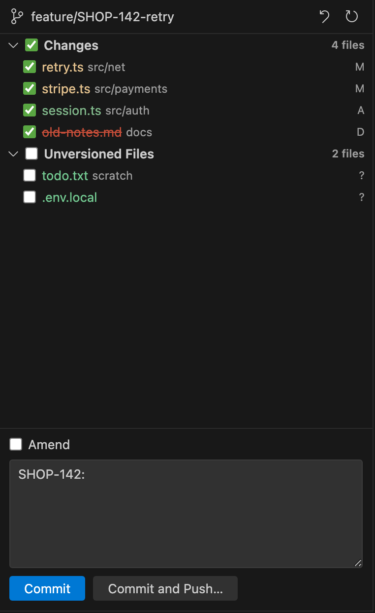
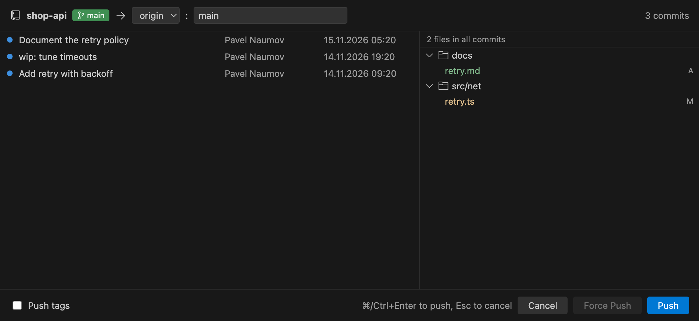

<p align="center">
  
</p>
<h1 align="center">GitJet</h1>
<p align="center">
  The IntelliJ IDEA Git workflow, in VS Code.<br>
  Graph log · Commit tool window · Push preview · Branch actions · Squash, reword, drop, cherry-pick
</p>
<p align="center">
  <a href="https://github.com/malinatrash/gitjet/actions/workflows/ci.yml"></a>
  <a href="https://github.com/malinatrash/gitjet/releases"></a>
  
  <a href="LICENSE"></a>
</p>



If your hands know `⌘K`, `⇧⌘K`, `⌘T` and "select a few commits → Squash", GitJet brings that muscle memory to VS Code:
the same tool windows, the same menus in the same order, the same shortcuts.

> GitJet is an independent project and is not affiliated with or endorsed by JetBrains.

## Features

### Git log — `⌘9` / `Alt+9`

Branches on the left, commit graph in the middle, changed files and the commit message on the right.

- Select one commit, a range (`Shift`) or scattered commits (`⌘`/`Ctrl`); `Enter` opens the diff, `F2` edits the message.
- Filter by text or hash, by author, or by branch (click a branch).
- Right-click commits: **Cherry-Pick**, Checkout Revision, Show Diff, Compare with Local, Reset Current Branch to Here…,
  Revert, Undo Commit…, **Edit Commit Message…**, **Fixup with Local Changes**, **Squash Commits…**, **Drop Commits**,
  Interactively Rebase from Here…, Push All up to Here…, New Branch…, New Tag….

| Commit menu | Squash |
| --- | --- |
|  |  |

Squash works on non-adjacent commits too. History edits run as scripted `git rebase -i` with autostash,
so uncommitted changes survive.

### Branch actions

Click a branch to filter the log, double-click to check it out, right-click for everything else:
Checkout, New Branch from…, **Checkout and Rebase onto**, Compare with, Show Diff with Working Tree,
**Rebase current onto**, **Merge into current**, Pull using Rebase / Merge, Update, Push…, Rename…, Delete.

The same actions are in the Branches popup: `` ⌃⇧` `` / `` Ctrl+Shift+` `` or the branch widget in the status bar.



### Commit tool window — `⌘K` or `⌘0` / `Ctrl+K` or `Alt+0`



- Changes and Unversioned Files with checkboxes.
- Commits exactly the checked files — whatever happens to be in the index stays as it was.
- **Amend**, **Commit** (`⌘Enter`), **Commit and Push…** (`⌥⌘Enter`), Rollback.
- Click a file to see its diff.
- The message starts with the issue key from the branch name: `feature/SHOP-142-retry` → `SHOP-142: `.
- Stash / Unstash in the view's `…` menu.

<br clear="right">

### Push — `⇧⌘K` / `Ctrl+Shift+K`

See what is about to leave your machine: outgoing commits, their files, the target remote and branch.

- Force push uses `--force-with-lease` and is disabled for protected branches.
- Rejected push? Choose Rebase or Merge and GitJet updates and pushes again.
- When the remote prints a merge/pull request link, the notification gets a **Create Merge Request** button.



### Automation

| | |
| --- | --- |
| **Undo Last Git Operation** (`⌥⇧⌘Z`) | Puts the branch back where it was before the last commit, amend, squash, rebase, reset or merge. Run it again to redo. |
| **Smart Checkout** | Local changes block a checkout? Stash → checkout → unstash in one click. |
| **Update Project** (`⌘T` / `Ctrl+T`) | Pull with merge or rebase, autostashing local changes. |
| **Delete Merged and Orphaned Branches…** | Bulk-delete local branches that are merged or whose remote branch is gone. |
| **Background fetch** | Every 10 minutes while the window is focused. |
| **Conflict flow** | A stopped rebase, merge or cherry-pick shows Resolve / Continue / Abort and a status bar indicator. |

### Multi-repository workspaces

All repositories in the workspace are discovered (workspace folders and repositories nested up to two levels deep).
Pick the one to work with from the switcher in the log toolbar, the Commit view, the status bar or the Branches popup;
the choice is remembered per workspace.

## Keymap

| Action | macOS | Windows / Linux | Replaces in VS Code |
| --- | --- | --- | --- |
| Commit | `⌘K`, `⌘0` | `Ctrl+K`, `Alt+0` | all `⌘K` chords, Focus Side Bar |
| Push… | `⇧⌘K` | `Ctrl+Shift+K` | Delete Line |
| Update Project | `⌘T` | `Ctrl+T` | Go to Symbol in Workspace |
| Git log | `⌘9` | `Alt+9` | Last Editor in Group |
| Branches… | `` ⌃⇧` `` | `` Ctrl+Shift+` `` | New Terminal |
| Undo Last Git Operation | `⌥⇧⌘Z` | `Ctrl+Alt+Shift+Z` | — |

`⌘9` and `⌘0` toggle: pressing them again hides the tool window.
These are the IntelliJ defaults and they deliberately take over the VS Code ones;
rebind anything in **Keyboard Shortcuts** (search for `gitjet`).

## Settings

| Setting | Default | |
| --- | --- | --- |
| `gitjet.updateMethod` | `merge` | How Update Project integrates incoming changes (`merge` / `rebase`). |
| `gitjet.protectedBranches` | `["main", "master"]` | Branches where force push is not allowed. |
| `gitjet.autoFetchMinutes` | `10` | Background fetch period; `0` disables it. |
| `gitjet.commit.issuePattern` | `[A-Z][A-Z0-9]+-\d+` | Finds the issue key in the branch name; empty disables the prefix. |
| `gitjet.commit.messageTemplate` | `{issue}: ` | Start of the commit message when an issue key is found. |
| `gitjet.followActiveEditor` | `false` | Switch the active repository to the one containing the active file. |
| `gitjet.log.pageSize` | `500` | Commits loaded per page. |

## Install

Search for **GitJet** in the Extensions view (once it is listed in the Marketplace), or download the `.vsix` from [Releases](https://github.com/malinatrash/gitjet/releases) and run:

```sh
code --install-extension gitjet-0.1.1.vsix
```

Requires Git 2.31+ and VS Code 1.90+.

## Not there yet

- Shelf and changelists, partial (per-hunk) commits.
- File history and Annotate.
- A dedicated interactive rebase editor — "Interactively Rebase from Here" opens `git rebase -i` in the terminal.
- History edits across merge commits are refused rather than attempted.
- Git runs without a terminal: authentication must work through an SSH agent or a credential helper.
  If git needs a prompt, GitJet offers to rerun the command in the integrated terminal.

## Architecture

```
src/git        domain layer with no vscode imports: executor, parsers, graph layout, rebase todo builder, services
src/protocol   typed RPC between the extension host and the webviews
src/host       VS Code layer: actions (one set of objects behind menus, popups and shortcuts), views, composition root
webview        Preact UI: log, commit and push
test           unit tests and integration tests against real temporary repositories
```

## Development

```sh
npm install
npm run watch      # then press F5 to launch the Extension Development Host
npm test
npm run package    # builds gitjet-<version>.vsix
```

## License

[MIT](LICENSE)
